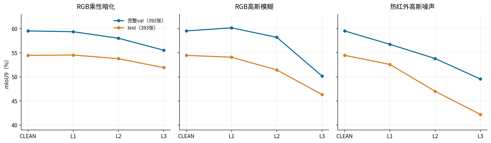
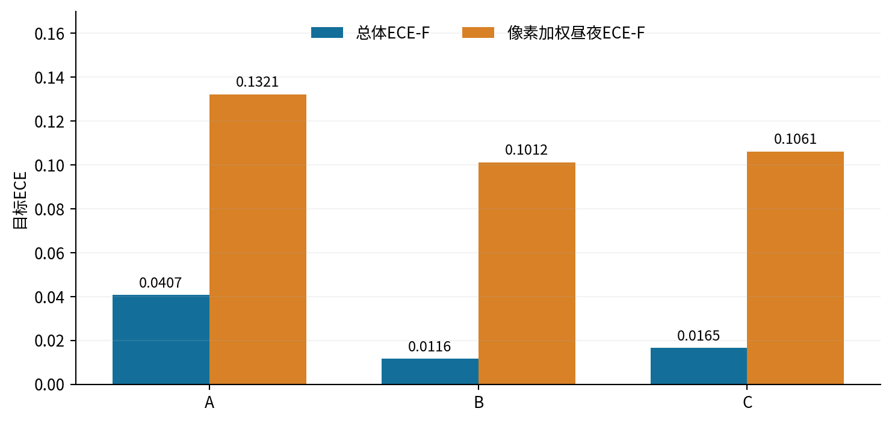

# RGBTAICourse

A coursework project on RGB-T semantic segmentation and prediction reliability under modality degradation.



---

## Overview

This repository provides the code and selected results for an Advanced Artificial Intelligence group project at Harbin Engineering University. We use a frozen SwiftFormer-CMX+ model to study how RGB darkening, RGB blur, and thermal Gaussian noise affect segmentation and pixel-level confidence on MFNet. The project compares thermal image restoration and residual adaptation, and uses temperature scaling to study calibration separately for daytime and nighttime scenes.

## Dataset

- [MFNet (processed)](https://drive.google.com/file/d/1qJOb6zqY9W0o0mKtWufljLgOLZJWfioJ/view?usp=sharing) uses the same directory layout as SwiftFormer-CMX+. Extract it so that `datasets/MFNet/` directly contains `images/`, `Thermal/`, and `labels/`.
- See the [original MFNet project](https://www.mi.t.u-tokyo.ac.jp/projects/mil_multispectral/index.html) for the dataset and its terms of use.

The fixed coursework splits are in [`configs/splits/`](configs/splits/).

## Model and Weights

- Base model code and training instructions are available in the [SwiftFormer-CMX+ repository](https://github.com/Y-Flying9264/SwiftFormer-CMX-plus).
- Download the [coursework checkpoint](https://drive.google.com/file/d/1ictG1rUsvX-fwS7vMTT0CuOr4P5YJcoE/view?usp=sharing) and place it at `weights/7SwiftFormer-CMX+.pth`.
- The residual parameters and fitted temperatures are included in [`assets/`](assets/).

The public SwiftFormer-CMX+ source differs from the snapshot used in the coursework experiments. [`configs/course.json`](configs/course.json) records the required source files, the checkpoint checksum, and the default paths.

## Repository Structure

```text
RGBTAICourse/
├── assets/               # Figures, frozen residual parameters, and fitted temperatures
├── configs/              # Model configuration and fixed MFNet splits
├── degradations.py      # Input degradation and restoration
├── evaluate.py          # Coursework experiments
├── model.py             # Base model loading and residual adaptation
├── reliability.py       # Calibration and reliability metrics
├── train_residual.py    # Residual head training
└── requirements.txt
```

## Installation

```bash
python -m pip install -r requirements.txt
```

The experiments used Python 3.10. For the same GPU setup, install the CUDA 12.8 wheels for PyTorch 2.8.0 and torchvision 0.23.0 before installing the remaining dependencies. See the [PyTorch installation instructions](https://pytorch.org/get-started/previous-versions/#v280).

---

## Results

On the 392-image MFNet validation split, strong thermal noise reduced the base model's 9-class mIoU from **59.53%** to **49.55%**. Temperature scaling changed the predicted probabilities and preserved the segmentation labels.

The table compares three restoration variants on the fixed 393-image test split. All variants apply Gaussian denoising to the thermal input. Variant B uses a shared linear residual head, while variant C selects a head using the dataset's day/night tag.

| Method | Clean mIoU₉ (%) | Moderate noise mIoU₉ (%) | Strong noise mIoU₉ (%) | Strong noise background false positive rate (%) |
| --- | ---: | ---: | ---: | ---: |
| A. Gaussian denoising | **54.453** | 51.077 | 47.538 | **0.586** |
| B. Denoising + shared residual head | 54.084 | **52.788** | **50.466** | 0.792 |
| C. Denoising + day/night residual heads | 54.438 | 52.182 | 49.392 | 0.715 |

Under strong thermal noise, B and C improved mIoU over A by **2.928** and **1.855** percentage points, respectively. Both increased background false positives. For B under the same condition, after temperature scaling, pooling foreground pixels gave an expected calibration error (ECE) of **0.0116**. Computing foreground ECE separately for day and night and weighting by pixel count gave **0.1012**.



---

## Acknowledgements

This coursework project was completed by **Hongyang YU, Zhuo CAO, Bingrui LI, Hongjin REN, and Yuhan ZHAO**.

We thank the developers of SwiftFormer-CMX+ and the authors of MFNet for making their code and data available.
